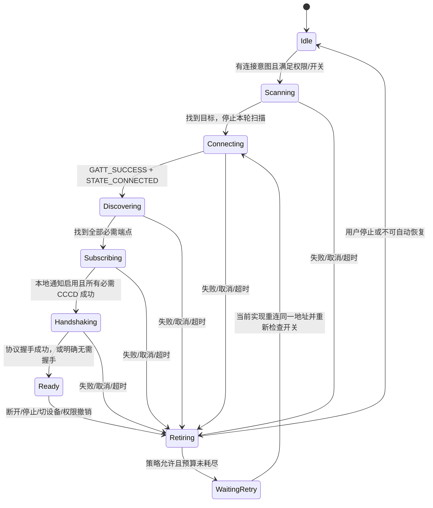

# 可选 Bluetooth / BLE 架构与源码参考

**搜索词：蓝牙、BLE、GATT、设备连接、断线重连、其他设备协议。用到时再接入。** 本目录随工程文档交付，Kotlin 文件位于 docs，不属于 Android 源集；没有注册 `ble` capability，不新增 SDK、Gradle 模块、Manifest 权限、扫描、连接、Service 或启动初始化。没有设备需求的项目跳过。

适用参考：Android BLE central / GATT client，基线 minSdk 26、compileSdk 35。经典蓝牙配对/A2DP/HFP、BLE peripheral/server、Mesh、广播测距、DFU/OTA 升级、安全认证不是这里已实现的能力。源码只经过静态核对，未做 Kotlin/Android 编译、自动测试或真机验证。

已有 [可接入 debug 的演练源码与映射](demo-integration.md)：真实扫描/选择连接/服务查看，加独立本地协议夹具。另提供 AndroidBleTransport（MTU、CCCD、全操作串行队列）、BleDeviceSessionManager（请求关联、握手与重连）及完整示例协议。它们也位于 docs，明确需要时逐项采用；不会默认启用蓝牙。通用查看页面仍只发现服务，不向未知设备发送教学协议。

**后续接其他协议，先读 [协议扩展接口、完整源码与接入步骤](protocol-adaptation.md)。** 该页列出实际接口、源码位置、组装方法和哪些参数必须来自真实设备文档；本地夹具已经调用相同的传输/协议/会话契约。尚未编译或验证真实设备。

逐项覆盖与剩余工作见 [生成结果与 Sony 对照](sony-comparison.md)。

## 从参考项目保留什么

来源是 SonyEarphone 的扫描器、BLE 连接管理、命令服务、写入门闩、接收流缓存、上层连接快照以及断线后重新检测流程。下文与本目录源码可独立阅读，未来不需要拿到 Sony 工程才能接入。

| 经验 | 模板里的处理 | 新设备必须提供的内容 |
|---|---|---|
| 扫描和连接分开 | 扫描负责有界发现、去重、停止及错误；会话负责选择和连接 | 广播识别、过滤、设备稳定身份；不能照搬 Sony UUID、MAC 哈希或型号目录 |
| 连接分阶段、状态一次发布 | 同一快照发布设备、会话、阶段和失败原因；UI 观察快照 | 真实 Ready 条件、降级功能；不能拿 A2DP 已连接代替 BLE 就绪 |
| 控制和数据共用连接写入口 | [BleGattWriteGate.kt](BleGattWriteGate.kt) 保留每连接串行、关闭唤醒和早到回调处理 | 平台适配、队列容量、回调超时、操作结果与设备 ACK |
| 通知先组帧再解释 | [BleFrameAssembler.kt](BleFrameAssembler.kt) 管理有界残片，协议提供 BleFrameFormat | 帧头/长度/转义/校验/重同步，不能默认每次通知就是一帧 |
| 协议可替换 | [ExampleLengthFrameFormat.kt](ExampleLengthFrameFormat.kt) 给出完整格式实现和分片/粘包调用 | 真实命令、响应、请求关联、握手、认证与设备能力 |
| 断连后重新检测 | [BleReconnectPolicy.kt](BleReconnectPolicy.kt) 提供有上限的退避决策 | 何时保持连接、暂停/恢复、尝试预算；不搬固定一秒重扫 |
| 音频与 BLE 传输分开 | 只保留独立流、背压和结束清理的组织经验 | 原生编解码器、采样率、设备音频格式、节奏/序号/丢包规则 |

`BleGattWriteGate` 是从来源代码整理的原语；组帧、教学协议、AndroidBleTransport、会话 broker 和重连策略是本模板新增的参考写法，不能视为 Sony 已经验证过它们。完整调用见协议扩展指南；不宣称覆盖所有设备的 ACK、安全或音频协议。

## 如何分层和放文件

模块边界遵守 [数据契约](../../rule/data-contract-rules.md)，生命周期遵守 [Manager 规则](../../rule/manager-lifecycle-rules.md)。下表是分工说明；实际已提供的类与精确路径以协议扩展指南的源码表为准，不能按建议类名猜 API。

| 角色及建议目录（模块主包下） | 职责 |
|---|---|
| base/bluetooth/ble/scan：BleScanner | Android 扫描原语，过滤参数、去重、截止时间、停止和技术错误，不自己选择 Sony 设备或自动弹权限 |
| base/bluetooth/ble/transport：BleTransport、AndroidBleTransport | 持有一条真实 GATT、平台版本差异、初始化与统一队列、MTU/CCCD、原始通知、超时及 close |
| base/bluetooth/ble/frame | 无业务的组帧机制；示例协议留在演练/文档中，不当生产默认协议 |
| support/<sdk>/ble | 仅在真实采用第三方 BLE/编解码 SDK 时创建技术适配；原生 GATT 不因是蓝牙就塞 support |
| model/manager/ble：BleDeviceSessionManager | 连接意图、重连预算、协议握手/请求所有权；显式 parentScope，长期 owner 由产品决定 |
| model/protocol/<deviceFamily> | 设备广播 Profile、端点/UUID、FrameFormat、CommandCodec、Handshake 等真实协议实现；此路径是本参考的接入建议，不是另一个 HTTP Service 目录 |
| model/state/device、bean/domain/device | 独立连接快照、业务设备信息、稳定错误语义；不向页面暴露 BluetoothGatt |
| app/di、ui/<feature> | 组合根组装所选协议；UI 按权限规则处理授权/系统开关，观察状态并使用公共反馈 |
| app/service/<runtime>（确有后台需求时） | 平台持续运行与前台通知，见 [Service 参考](../service/README.md)；BLE 本身不要求创建 Service |

可拆成“平台传输 + 设备协议 + 会话编排 + 展示”四部分。未来新协议复用传输机制，增加自己的 Profile/格式/命令/握手；它可能需要不同的安全、订阅、MTU 或并行策略，不承诺只改 UUID 就适配所有设备。不要复制一个越来越大的 SonyBluetoothManager，也不为每个新设备重写 Android 回调。

## 一次连接的明确边界



MTU 可放在连接后的串行初始化链，具体顺序按设备要求定义；requestMtu 返回拒绝或回调缺失不能永远卡住发现服务。以 onMtuChanged 的成功结果更新实际值，未成功保留合法默认值；Android 14 起请求行为由系统控制，不能硬写“申请 517 = 每次能发 514”。普通 ATT 写入通常受 MTU-3 限制，另受操作类型/属性值上限和设备协议限制；完整协议帧与单次 GATT 写入长度不是同一概念，长帧分片必须按真实协议实现。PHY/连接优先级是可选优化，申请成功不保证实际协商值。

`setCharacteristicNotification(true)` 只打开本地接收，不代表远端订阅成功。按 characteristic properties 选择 notify/indicate，检查 CCCD 存在，串行写入并等待匹配的成功回调；多个订阅逐个完成。Bond/encryption/MITM 按设备安全契约处理，properties 与 permissions 是不同位域，不能混用常量判断加密。

Ready 之前禁止普通业务命令。握手应有截止时间，记录当前会话；可选的型号/电量读取失败是否影响 Ready，由设备协议和业务决定，不默认照搬 Sony 的 OTA/非 OTA 分类。

## 旧回调必须跟旧连接一起退休

每次连接尝试创建新的会话对象，包含 token、原始 GATT、队列/门闩、缓冲、待响应表、截止任务及 Scope。所有状态写入走一个串行 owner；Android 回调先复制输入并投递到该 owner，再同时检查：

```kotlin
// 接入片段；activeSession、capturedSession、gatt 为真实 owner 的字段/回调参数。
if (activeSession !== capturedSession || capturedSession.gatt !== gatt) return
```

不仅 onCharacteristicWrite，连接状态、服务发现、MTU、CCCD、通知、延迟任务和协议响应都要检查。同一个 MAC 的下一次连接也是新会话，地址相同不能代替身份判断。创建回调时捕获原会话，不能在回调里读取“当前 GATT”再把旧事件派给新连接。连接调用也在 owner 上执行；初始化回调投递后才处理，避免同步/重入回调先于句柄绑定。

Android 13+ 通知处理使用回调的 `value.copyOf()`，旧签名只在 API < 33 时读取 characteristic.value 并立即复制；避免双入口重复处理或读到后续覆盖的可变值。投递队列必须有容量和溢出策略：控制/握手通知不能静默丢弃，音频是否丢旧/终止由协议决定。不同 characteristic 的独立字节流使用独立 assembler，不能误拼。

停止时先撤销连接意图/使 token 失效，取消扫描、重连和阶段任务，失败完成所有等待者，清理缓冲/监听，再在同一平台 owner 退役原始 GATT（disconnect 后确保 close，不依赖断开回调一定到达）。关闭门闩唤醒旧等待者；等待者醒来仍需检查身份。close 幂等；重复停止、晚到回调不能关闭新 GATT。单项关闭异常不能跳过其他资源释放。不能反射调用隐藏 refresh() 作为默认恢复。

## 单写门闩与完整操作队列

现有 AndroidBleTransport 已使用一套有界准入 + Mutex + 匹配回调等待者，覆盖全部 GATT 操作；不要在它外面再套一把独立 BleGattWriteGate。下面保留的门闩片段用于理解原始单写机制，示意方法不属于 AndroidBleTransport API；实际采用优先读 [完整源码](protocol-adaptation.md)。

[BleGattWriteGate](BleGattWriteGate.kt) 只管一条连接的 characteristic write：调用返回和对应本地回调都到达后释放；立即拒绝/抛错不等不存在的回调。它不保存业务帧、没有容量/截止时间，不返回设备执行结果，也不串行 descriptor/read/MTU/discovery。

```kotlin
// 接入片段，不是现成 send API。由连接 owner 执行，禁止 UI/回调线程阻塞等待。
val turn = connection.writeGate.acquire(characteristic.instanceId)
    ?: return connectionClosedResult
var accepted = false
try {
    // 在取得门闩后再次检查原连接身份、存活状态、取消和单次写入大小。
    ensureCurrentConnectionAndActiveCoroutine()
    // 先登记 callback 等待者和 deadline，才能处理早到回调。
    registerWriteCompletionBeforeSubmitting()
    // API 33+ 使用 writeCharacteristic(characteristic, ownedBytes, writeType)，
    // BluetoothStatusCodes.SUCCESS 仅表示受理；旧 API 在此门闩内设置 value/writeType。
    accepted = submitOnePlatformWrite()
} finally {
    turn.onInvocationReturned(accepted)
}
// 本地 characteristic 回调先校验原 GATT/会话/特征，记录 status 并完成等待者，
// 再交给原 connection.writeGate.onWriteCompleted(instanceId)。
// 方法最后返回等待者的真实成功/失败；accepted 不能当作设备命令成功。
```

片段中的组装方法和结果类型由真实传输实现，模板没有伪造平台成功。所有提交必须汇聚同一入口：若初始化与业务阶段严格隔离，可初始化时串行完成 CCCD/MTU，Ready 后只进行 characteristic write；如果运行期还需 read/descriptor/MTU，则补完整的 **单连接 GATT operation queue**，统一操作类型、目标、等待者、容量、取消和超时，不能另开一把互不相知的锁。`onExternalOperationCompleted` 只唤醒 busy 重试，不会把 descriptor 当 characteristic 完成。

缺失回调或提交后取消可能留下平台操作：停止发新操作并退役整个旧连接；不能超时后简单释放槽继续写同一特征，否则晚回调会错误完成下一条。等待入队时取消可仅撤销未提交动作。显式 busy/立即拒绝才考虑有界重试，旧 API false 原因未知，不能无限当 busy；受理成功后不要自动重复发送。回调失败 status 是传输错误，不是成功 ACK。无响应写也需遵循目标 Android 栈的本地完成行为和截止策略，不能把本地回调当成对端确认。

业务命令若有 ACK/响应，关联键至少含会话和协议请求 ID/命令/序号；序号回绕、重复/乱序、通知先于调用返回、响应超时、取消都由协议适配明确。本地写完成、协议 ACK、设备操作完成三者分开。重连后是否允许重发由命令幂等性决定；升级/开锁/扣费等不能猜测重发。

## 组帧与重连的真实调用参考

`exampleFragmentAssembly()` 演示半帧跨两次通知、一次通知三帧以及 payload 内包含 marker。[演示格式](ExampleLengthFrameFormat.kt) 的长度/校验是教学夹具，不能拿去连接 Sony 或未知设备。新协议实现 BleFrameFormat：NeedMore 留下有界残片、Discard 明确丢弃量、Complete 只返回完整且校验成功的帧；业务解析随后进行。坏长度不能无限分配，连接退出清空缓存，协议要求的残帧时限另由会话管理。`feed()` 出错会清空并抛错，本次已解析但未返回的帧也不交付；会话须按协议停止/恢复，不能吞错当全部成功。

重连策略用法：

```kotlin
// 教学配置，不是所有设备默认值；数值由功能 Spec 确认后注入。
val policy = BleReconnectPolicy(maxAttempts = 4, initialDelayMs = 1_000, maxDelayMs = 12_000)
val delayMs = policy.nextDelayMs(
    cause = BleDisconnectCause.LINK_LOST,
    attempt = 1,
    wantsConnection = true,
    permissionGranted = true,
    bluetoothEnabled = true,
)
// 非 null：owner 取消旧 retry Job 后安排唯一一次可取消延迟；到期再次核对
// token/目标设备/意图/权限/开关，创建新会话，不复用旧队列/缓冲/待响应命令。
// null：发布需要用户操作或预算耗尽的状态；不会由 policy 自动扫描/连接。
```

用户停止、切设备、权限撤销/蓝牙关闭、协议不支持、认证被拒不能无限重连。恢复权限/开关后是否继续由连接意图决定；BLE 不应依赖“有互联网”才能恢复。尝试计数由 owner 维护，不在每次 GATT_CONNECTED 时清零；按 Spec 的稳定 Ready 窗口或明确用户重试重置，防止连接抖动绕过预算。后台重试需满足系统限制，不能把进程内 delay 当持久任务。

## 权限、SDK 和后续接入

按 [权限规则](../../rule/permission-rules.md) 在触发真实动作时请求所需 List，全部必需项满足后开始；拒绝保留不可用状态并提供既有 Toast/设置引导，不能造一套蓝牙专用重复权限框。Manifest、权限和系统开关分别核对：API 31+ 常用 BLUETOOTH_SCAN/CONNECT；旧版本扫描可能需要定位权限/开关。neverForLocation、maxSdkVersion、后台扫描及定位用途须按产品和 Android 版本确认，不能无条件套清单；不做广播则不自动申请 ADVERTISE。

BLE 传输本身用 Android GATT，不新增第三方 BLE SDK。参考代码的门闩使用项目已有 kotlinx-coroutines（当前基线 1.7.3）；其余三份 Kotlin 文件只用标准库。实际启用时按选定模块检查显式依赖和内部可见性，移动 package/import；当前 `.reference.ble` 包仅为便于一起阅读。无 Manifest/资源/R8 运行配置随参考启用。

Sony 的 Codec.aar、LC3/Opus/Speex 等编解码、ASR、录音/SCO 路由不是 BLE 必需项，不复制 AAR、仓库凭据或原生文件。确有音频需求再分别分析许可证、ABI、minSdk、16 KB page 支持、线程和关闭契约，放 support 做技术适配，model 决定设备音频协议；不能把“无第三方 BLE SDK”当作音频链也无 SDK。

未来接入顺序：读本页与协议扩展指南 → 补设备 Spec（广播、端点/属性、安全、帧/命令、Ready、所有者、后台需求）→ 实现设备协议，组合已有传输/会话并评估其限制 → 接 UI/权限/反馈 → 登记真实组件/依赖和验证结果。当前没有一键安装命令，不能往配置中写未注册的 `ble`；已有工程不能重跑初始化器覆盖。

至少覆盖：重复扫描/连接、扫描失败/超时、权限 List 部分拒绝及运行中撤销、蓝牙关闭、MTU 拒绝/缺回调、缺服务/特征/CCCD、订阅失败、握手失败、半包/粘包/坏校验/超长帧、写 busy/缺回调/早回调、入队前后取消、断线唤醒、同 MAC 重连旧回调、切设备、重试耗尽、重复关闭、后台限制。涉及真实设备/编译/测试时由用户授权后执行；本目录不声称已完成这些验证。
